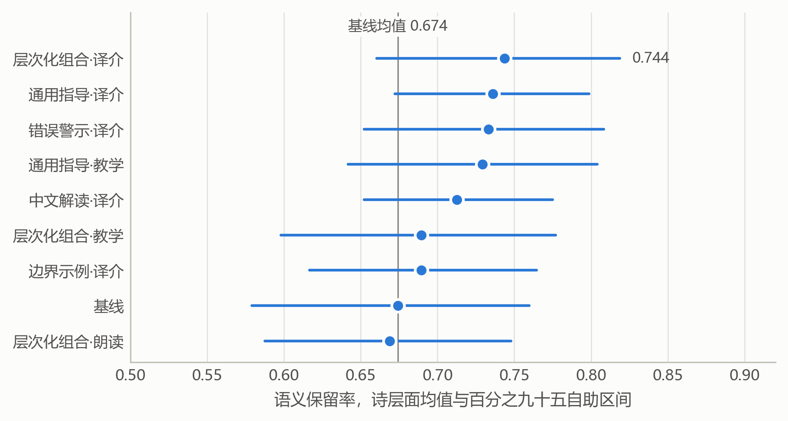
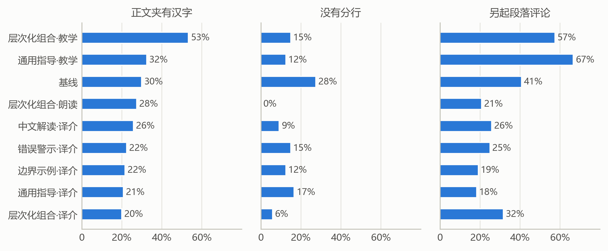
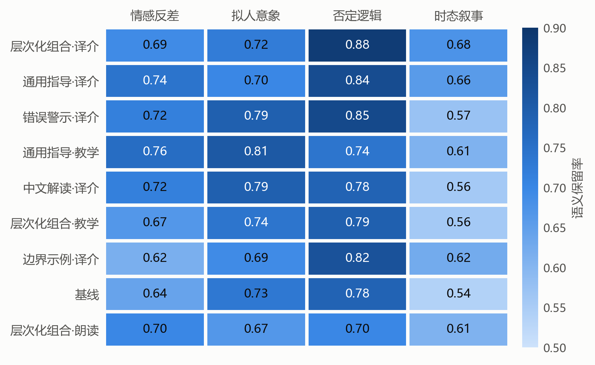
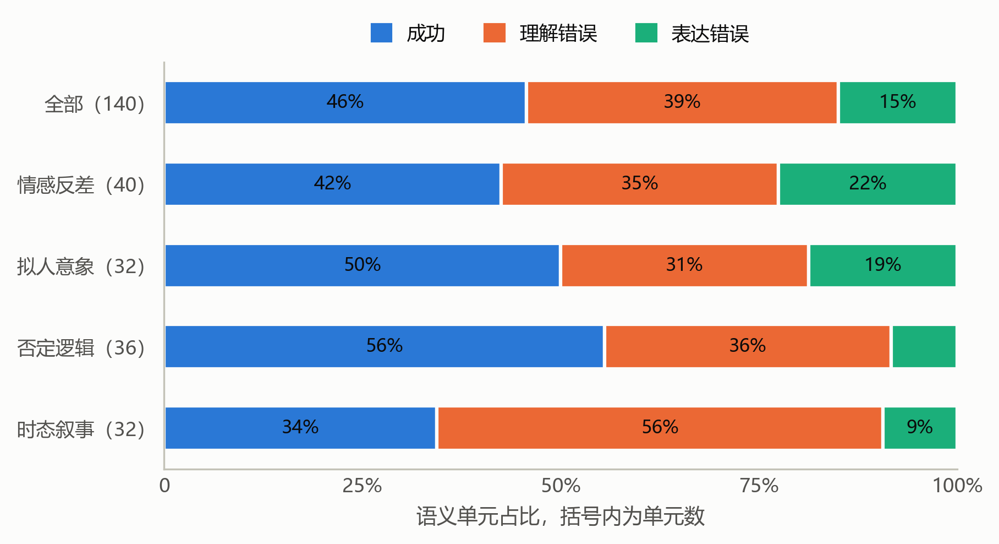

# 古诗词英译提示策略实证研究

[](https://github.com/rain-xhy/poetry-prompt-lab)
[](https://www.python.org/)
[](https://huggingface.co/Qwen)
[](./文档/报告/完整论文_最终版.md)

基于语义陷阱分类的古诗词英译提示策略系统性研究，包含 4 个阶段、9 种策略、1534 次生成，覆盖通用指导、中文解读、边界示例、错误警示及其层次化组合等维度。

## 📊 核心发现

- **策略效应**：9 种策略在 20 首诗上的语义保留率在 0.669 到 0.744 之间，36 对比较经 Holm 校正后**全部不显著**
- **陷阱难度**：时态叙事类最难（均值 0.601），否定逻辑类最易（0.800），差 **19.9 个百分点**
- **模型依赖**：两个模型的策略排序斯皮尔曼相关为 **-0.10**（p=0.798），几乎不相关
- **错误归因**：理解错误占 **39.3%**，表达错误占 **15.0%**，理解是更大瓶颈
- **评审一致性**：评审器与人工判断一致率 **72.6%**（κ=0.415），中等水平
- **格式问题**：约 **30%** 译文正文夹杂未翻译的汉字
- **用途失效**：朗读与教学用途未带来目标维度提升，反而质量分更低

## 🗂️ 项目结构

```
poetry-prompt-lab/
├── data/                   # 测试材料
│   ├── main_test/         # 主测试集（20 首诗）
│   ├── dev_set/           # 开发集（6 首诗）
│   ├── adversarial/       # 对抗集（11 个文本）
│   └── semantic_units/    # 134 个语义单元标注
├── prompts/               # 提示策略
│   ├── S0_baseline.txt   # 零提示基线
│   ├── S1_T1_guidance.txt # 通用指导
│   ├── S5_T1_combined.txt # 层次化组合
│   └── ...
├── results/               # 实验结果
│   ├── stage1_dev/       # 阶段 1：开发集（216 次生成）
│   ├── stage2_main/      # 阶段 2：主测试（1080 次生成）
│   │   ├── translations/ # 1080 份译文 JSON
│   │   ├── scores/       # 评分结果
│   │   ├── analysis/     # 统计分析
│   │   │   ├── paired_accuracy.csv
│   │   │   ├── strategy_means.csv
│   │   │   └── anova_results.json
│   │   └── figures/      # 7 张实验图表
│   ├── stage3_adversarial/ # 阶段 3：对抗集（198 次生成）
│   └── stage4_path/      # 阶段 4：路径分析（40 次生成）
├── scripts/               # 实验脚本
│   ├── generate.py       # 批量生成译文
│   ├── score.py          # 自动评分
│   ├── analyze.py        # 统计分析
│   └── plot_figures.py   # 绘制图表
├── models/                # 模型配置
│   ├── qwen2.5_3b.json
│   └── qwen3_1.7b.json
└── README.md

```

## 🚀 快速开始

### 环境要求

- Python 3.8+
- Ollama（用于本地部署模型）
- Qwen2.5 3B Instruct / Qwen3 1.7B
- pandas, numpy, scipy, matplotlib, seaborn

### 安装

```bash
# 克隆仓库
git clone https://github.com/rain-xhy/poetry-prompt-lab.git
cd poetry-prompt-lab

# 安装 Ollama
curl -fsSL https://ollama.com/install.sh | sh

# 拉取模型
ollama pull qwen2.5:3b-instruct
ollama pull qwen2:1.7b

# 安装 Python 依赖
pip install pandas numpy scipy matplotlib seaborn
```

### 运行实验

```bash
# 阶段 1：开发集策略筛选
python scripts/generate.py --stage dev --strategies all

# 阶段 2：主测试集完整评测
python scripts/generate.py --stage main --strategies S0,S1_T1,S1_T3,S2_T1,S3_T1,S4_T1,S5_T1,S5_T2,S5_T3

# 评分
python scripts/score.py --stage main

# 统计分析
python scripts/analyze.py --stage main --output results/stage2_main/analysis/

# 绘制图表
python scripts/plot_figures.py --stage main
```

## 📈 实验阶段

| 阶段 | 任务 | 文本数 | 策略数 | 生成次数 | 核心发现 |
|------|------|--------|--------|---------|---------|
| 1 | 开发集筛选 | 6 首诗 | 9 种 | 216 | 6 首诗不足以产生稳定排序（ρ=0.071）|
| 2 | 主测试评测 | 20 首诗 | 9 种 | 1080 | 策略主效应不显著（F=0.503, p=0.853）|
| 3 | 对抗集验证 | 11 个文本 | 3 种 | 198 | 施受反转陷阱敏感度高 |
| 4 | 路径分析 | 20 首诗 | 1 种 | 40 | 理解错误 39.3% > 表达错误 15.0% |

## 🎯 提示策略

### 策略分类

**基线**
- `S0`：零提示（仅翻译指令）

**单成分策略**
- `S1_T1`：通用指导 + 忠实译介
- `S1_T3`：通用指导 + 课堂教学
- `S2_T1`：中文解读 + 忠实译介
- `S3_T1`：边界示例 + 忠实译介
- `S4_T1`：错误警示 + 忠实译介

**层次化组合**
- `S5_T1`：解读+示例+警示 + 忠实译介（均值最高 0.744）
- `S5_T2`：解读+示例+警示 + 诗歌朗读（均值最低 0.669）
- `S5_T3`：解读+示例+警示 + 课堂教学

### 策略性能对比

| 策略 | 均值 | 标准差 | 95% 区间 | 排名 |
|------|------|--------|---------|------|
| S5_T1 | 0.744 | 0.186 | [0.660, 0.819] | 1 |
| S1_T1 | 0.736 | 0.146 | [0.672, 0.799] | 2 |
| S4_T1 | 0.733 | 0.192 | [0.652, 0.808] | 3 |
| S1_T3 | 0.729 | 0.195 | [0.642, 0.804] | 4 |
| S2_T1 | 0.713 | 0.147 | [0.652, 0.775] | 5 |
| S5_T3 | 0.690 | 0.211 | [0.598, 0.777] | 6 |
| S3_T1 | 0.690 | 0.172 | [0.617, 0.765] | 7 |
| S0 | 0.674 | 0.213 | [0.579, 0.760] | 8 |
| S5_T2 | 0.669 | 0.197 | [0.588, 0.748] | 9 |

**注**：所有区间大幅重叠，36 对比较经 Holm 校正后全部不显著（p=1.0）

## 📊 主要结果

### 图1：策略均值与置信区间



所有策略的 95% 区间彼此大幅重叠，说明差异不显著。

### 图2：格式遵从率



S5_T3（教学用途）汉字夹杂率最高达 53%。

### 图4：陷阱类型热图



时态叙事类整体最难（颜色最浅），否定逻辑类最容易（颜色最深）。

### 图7：错误归因分布



理解错误（39.3%）明显多于表达错误（15.0%）。

更多图表见 [results/figures/](./results/figures/)

## 🔬 方法创新

### 1. 语义陷阱分类框架

按译文易错的语义关系分为 4 类：

| 陷阱类型 | 定义 | 示例 | 典型错误 |
|---------|------|------|---------|
| **情感反差** | 同一句中并置相反情绪 | 多情却似总无情 | 把张力压平 |
| **拟人意象** | 无生命事物充当施事 | 蜡烛有心还惜别 | 削弱拟人或错指主体 |
| **否定逻辑** | 否定通过虚词或语境表达 | 不教胡马度阴山 | 把否定译成肯定 |
| **时态叙事** | 省略、回忆与设想交错 | 春眠不觉晓 | 混淆时间或添加事件 |

### 2. 递进式提示框架

4 类可独立增减的成分：

- **通用指导**：说明用途与读者对象（T1 忠实译介、T2 朗读、T3 教学）
- **中文解读**：连缀语义单元为完整理解陈述
- **边界示例**：给出错误与正确并列的译法
- **错误警示**：对常见失误作明确否定性指令

边际贡献通过配对比较单独估计。

### 3. 翻译路径分析

要求模型先陈述理解再给出译文，将错误归因到：
- **理解错误**：理解陈述不通过
- **表达错误**：理解通过但译文不通过
- **成功**：理解与译文都通过

**发现**：理解是更大瓶颈（39.3% vs 15.0%）

### 4. 多层评价体系

**第一层**：语义单元二元核对（通过/不通过）
- 评审器引用译文原词作证据
- 引文找不到的按不通过计

**第二层**：5 维质量评分（1-5 分）
- 诗歌意象、语言优美、译文流畅、文化传达、整体质量

**第三层**：用途适配度（1-5 分）
- 忠实译介适合度、朗读适合度、教学适合度

## 📚 数据集

### 主测试集

**来源**：唐宋诗词经典篇目  
**规模**：
- 诗词数：20 首
- 语义单元：80 个
- 陷阱类型：4 类各 5 首

**陷阱分布**：
- 情感反差：M01-M05（《赠别》《相思》等）
- 拟人意象：M06-M10（《春晓》《乌衣巷》等）
- 否定逻辑：M11-M15（《静夜思》《登鹳雀楼》等）
- 时态叙事：M16-M20（《商山早行》《锦瑟》等）

### 对抗集

**构造方式**：主动改写，增强特定陷阱
- A05：双重否定（通过率 0.89-0.94）
- A06：施受反转（通过率 0.11-0.50）
- A07A/B：歧义对照
- A09：时态混淆

## 🛠️ 模型对比

### Qwen2.5 3B vs Qwen3 1.7B

| 模型 | 参数 | 整体均值 | S0 基线 | 最佳策略 | 策略排序一致性 |
|------|------|---------|---------|---------|---------------|
| Qwen2.5 3B | 30 亿 | 0.702 | 0.628 | S5_T1 (0.750) | ρ = -0.10 |
| Qwen3 1.7B | 17 亿 | 0.715 | 0.721 | S4_T1 (0.742) | p = 0.798 |

**结论**：策略效果依赖具体模型，不存在通用写法

### 评审器选择

| 模型 | 参数 | 可用性 | 一致率 | 卡帕系数 |
|------|------|--------|--------|---------|
| Qwen2.5 3B | 30 亿 | ❌ 不可用 | - | - |
| **Qwen3 4B** | 40 亿 | ✅ 可用 | 72.6% | 0.415 |
| Gemma2 2B | 20 亿 | 对照 | 68.3% | - |

**失败案例**：Qwen2.5 3B 通过率仅 1.0%，过度保守

## 📖 完整报告

详细技术报告见：[完整论文](./文档/报告/完整论文_最终版.md)（约 650 行，含 12 张表格、7 张图表）

**论文结构**：
1. 引言
2. 相关工作
3. 方法（材料、策略、评价、评审器校准、统计方法）
4. 实验设置（模型、流程、与原设计差异）
5. 结果（一致性、格式、策略比较、陷阱类型、模型一致性、质量分、对抗集、路径分析）
6. 讨论（研究问题回答、策略无差异解释、评审器限定、局限性）
7. 结论

## 🎯 应用建议

### 模型选择

| 场景 | 推荐配置 | 理由 |
|------|---------|------|
| **资源受限** | 30 亿参数 + 简单提示 | 复杂提示边际收益不明显 |
| **质量优先** | 70 亿参数以上 | 小模型能力不足 |
| **格式严格** | 添加格式检查后处理 | 30% 译文夹杂汉字 |

### 提示策略

| 任务 | 推荐策略 | 避免 |
|------|---------|------|
| **通用翻译** | S1_T1（通用指导） | 避免过长提示 |
| **特定陷阱** | S5_T1（层次化组合） | 但效果不稳定 |
| **朗读/教学** | 避免专用用途提示 | 未带来目标提升 |

### 评价方法

| 维度 | 推荐方法 | 注意事项 |
|------|---------|---------|
| **语义保留** | 逐单元二元核对 | 需要人工校准 |
| **整体质量** | 多维评分 | 评分同源问题 |
| **错误归因** | 路径分析 | 理解 > 表达 |

## 📄 引用

如果本研究对您有帮助，请引用：

```bibtex
@misc{han2025poetry,
  author = {Han, Yu},
  title = {Empirical Study of Prompt Strategies for Classical Chinese Poetry Translation},
  year = {2025},
  publisher = {GitHub},
  url = {https://github.com/rain-xhy/poetry-prompt-lab}
}
```

## 📝 License

本项目采用 MIT License 开源。

## 🤝 致谢

- 北京大学软件与微电子学院俞老师提供的学术指导
- Qwen 系列模型的开发团队
- Ollama 框架的维护者

## 📧 联系方式

- 作者：韩雨
- 邮箱：[312108382@qq.com]

---

**最后更新**：2025年1月15日
